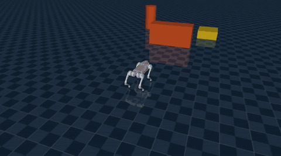
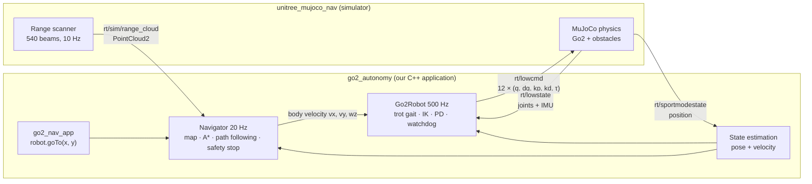
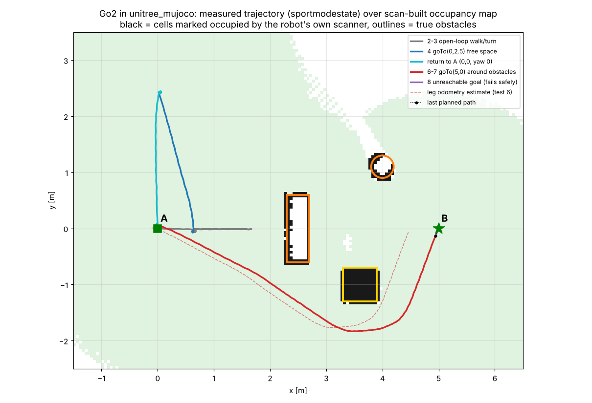

# unitree-robots

**Autonomous navigation for the Unitree Go2, in C++, on Unitree SDK2 and the official `unitree_mujoco` simulator.**
The robot stands up, walks on its own four legs from A to B, detects obstacles with a range scanner, plans around
them and reports success or failure from measured feedback. Everything goes through real DDS commands and feedback:
`rt/lowcmd` out; `rt/lowstate`, `rt/sportmodestate` and a scan topic in. There is no teleporting.

<p align="center">
  <br>
  <em>Replay of a test run (2.5× speed). The red dots are the measured path; the goal is the green disc behind the wall.</em>
</p>

```cpp
go2::Go2NavigationSystem robot;            // simulator defaults: DDS domain 1, interface "lo"
robot.start();
robot.standUp();
go2::NavResult r = robot.goTo(5.0, 0.0);   // blocking, obstacle-aware
if (r.success) { /* r.position_error, r.elapsed, r.distance_travelled ... */ }
```

## Quick start (Ubuntu 22.04 / 24.04, x86_64)

```bash
git clone https://github.com/appraid-unitree/unitree-robots.git && cd unitree-robots
bash scripts/install_deps.sh        # once: apt packages (needs sudo)
bash scripts/build.sh               # builds everything inside the repo (~2 min)

bash scripts/run_sim.sh             # terminal 1: simulator + obstacle arena
bash scripts/run_nav_demo.sh        # terminal 2: robot walks A -> B around the obstacles
```

👉 **The illustrated step-by-step guide, with screenshots, expected output and troubleshooting, is
[docs/GETTING_STARTED.md](docs/GETTING_STARTED.md).**

## What's in the repository

```
unitree-robots/
├── go2_autonomy/            ← OUR CODE: locomotion, estimation, mapping, planning, navigation, apps
│   ├── apps/go2_nav_app.cpp       the main (business) application: robot.goTo(x, y)
│   ├── apps/go2_acceptance_tests.cpp
│   ├── include/ src/              the library (see go2_autonomy/README.md)
│   └── docs/                      HARDWARE_NOTES.md, validation results
├── unitree_mujoco/          ← official simulator (vendored) + our additions:
│   ├── simulate/nav_ext/          unitree_mujoco_nav = stock simulator + simulated range scanner
│   └── unitree_robots/go2/scene_nav.xml   obstacle arena
├── unitree_sdk2/            ← official Unitree SDK2 (vendored, unmodified)
├── third_party/mujoco-3.3.6/← MuJoCo 3.3.6 Linux x86_64 release (vendored)
├── examples/stand_go2_3step/← the original 3-step stand-up / sit-down controller
├── scripts/                 ← install_deps · build · run_sim · run_nav_demo · run_acceptance_tests
└── docs/                    ← GETTING_STARTED.md, images
```

All dependencies are inside the repo at the tested versions (`THIRD_PARTY.md`), so a clone builds without
downloading anything except the Ubuntu packages. Nothing is installed outside the repo: the SDK goes to `.install/`.

## How it fits together



## Verified results (in simulation)

The acceptance tests passed 8/8 in six independent runs. The checks use measured feedback and an independent collision oracle:

| # | Test | Result (final run) |
|---|---|---|
| 1 | Stands stably | max tilt 0.009 rad, drift 2 mm |
| 2 | Walks straight (forward and back) | 1.73 m in 4 s, 13 mm lateral drift |
| 3 | Turns | ±3.13 rad in 4 s at ±0.8 rad/s |
| 4 | Reaches a goal in free space | error 0.075 m |
| 5 | Detects the blocking obstacle | straight path A→B marked blocked |
| 6 | Navigates around it | 1.8 m detour, 0.28 m min clearance, no contact |
| 7 | Reaches B (5, 0) | 20.8 s, error 0.073 m |
| 8 | Reports failure honestly | unreachable goal → FAILURE, no collision |



Details, design decisions and limits are in [go2_autonomy/README.md](go2_autonomy/README.md).

## Status and limits

* **Simulation only.** Nothing has run on a physical Go2. Before going near hardware, read
  [go2_autonomy/docs/HARDWARE_NOTES.md](go2_autonomy/docs/HARDWARE_NOTES.md). `go2_nav_app` refuses
  DDS domain 0 (the real robot) unless explicitly overridden.
* The navigation pose comes from the simulator's `rt/sportmodestate`. A real robot needs LiDAR odometry or SLAM instead.
* Not tested: stairs or terrain, moving obstacles, speeds above 0.7 m/s.

---
© Appraid-tech. Third-party components and their licenses: see [THIRD_PARTY.md](THIRD_PARTY.md).
