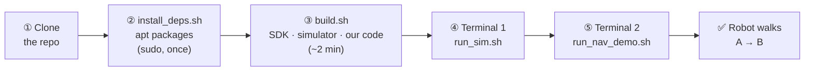
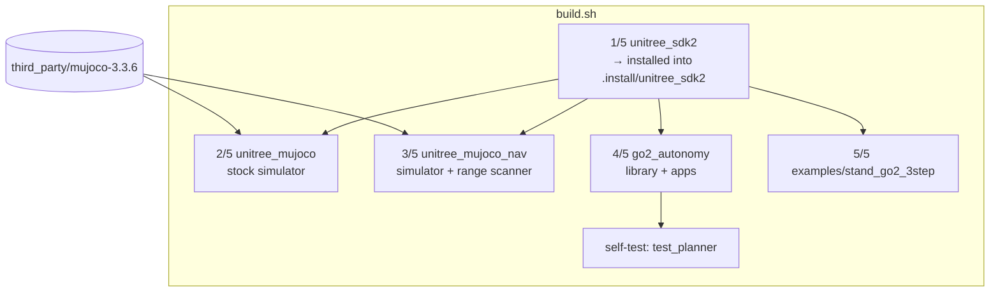
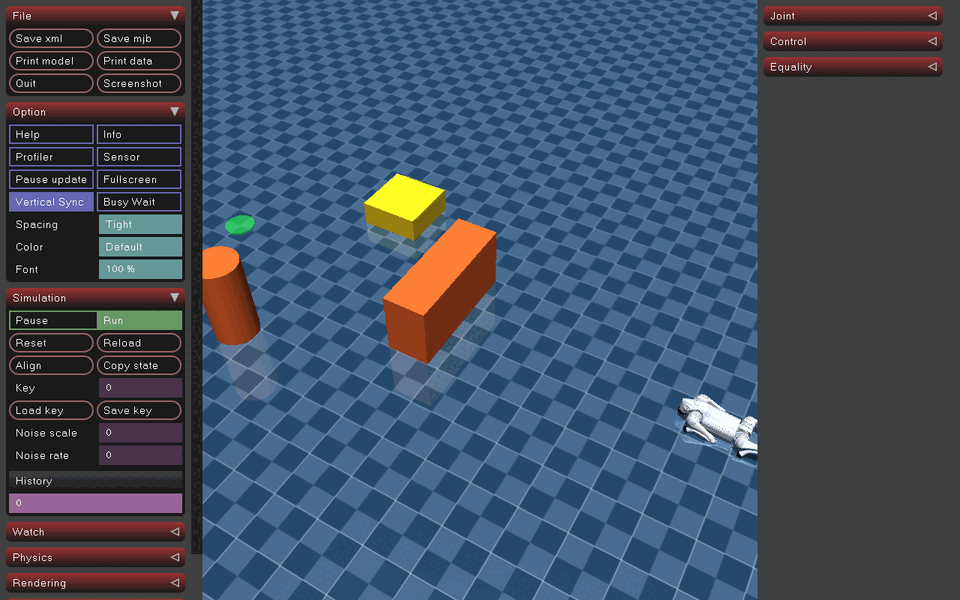
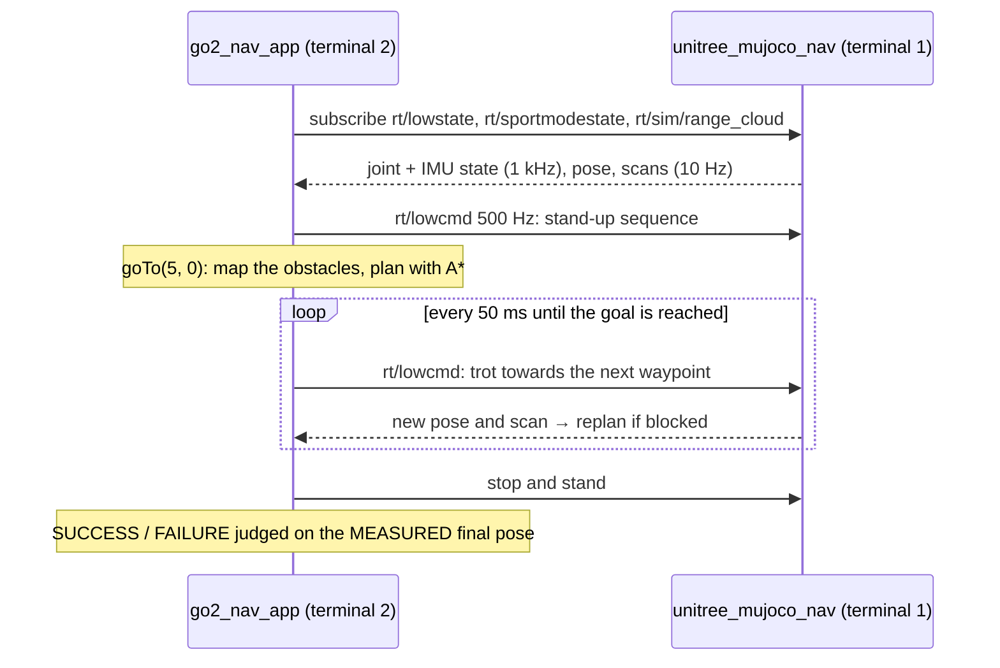
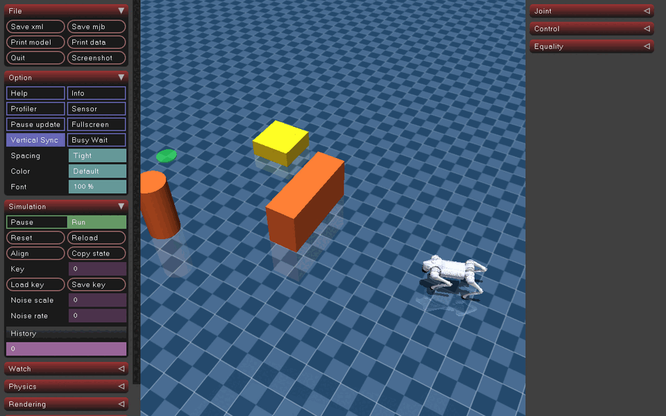
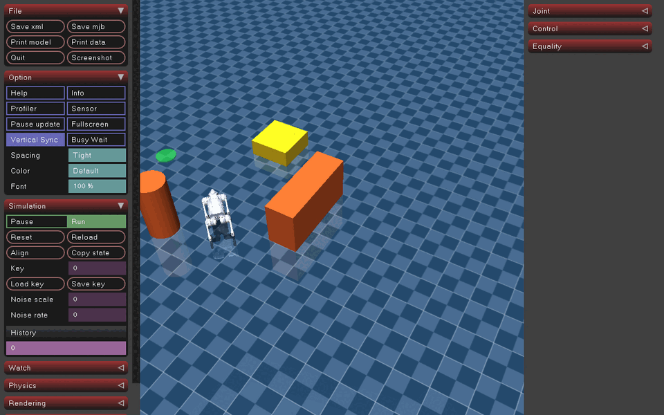
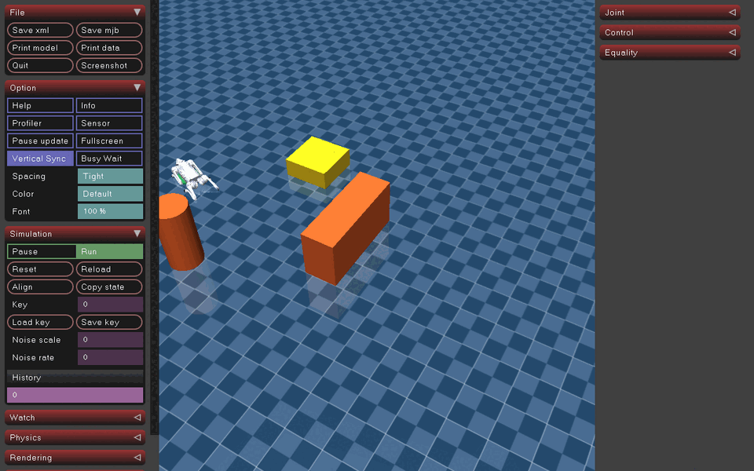

# Getting started: compile and run the Go2 simulation locally

From a fresh Ubuntu machine to a Go2 walking around obstacles in about 10 minutes.



**You need:**
* Ubuntu 22.04 or 24.04 on x86_64
* a desktop session, because the simulator opens a window
* about 1.5 GB of free disk space
* `git`
* sudo, for the package installation only

---

## ① Get the repository

```bash
cd ~/robotics          # or any folder you like
git clone https://github.com/appraid-unitree/unitree-robots.git
cd unitree-robots
```

> The repository is public, so no GitHub account is needed to clone it. The download is about 120 MB, because the
> Unitree SDK, the simulator and MuJoCo are included.

## ② Install the system packages (once per machine)

```bash
bash scripts/install_deps.sh
```

This installs the compiler, CMake, GLFW (the simulator window), yaml-cpp, spdlog, fmt and boost. It is the only step
that needs `sudo`.

## ③ Build everything

```bash
bash scripts/build.sh
```



The build ends with this output (about 2 minutes on a 2-core machine):

```
==> Self-test (offline, no simulator needed)
[PASS] wall blocks the straight line
[PASS] A* detours around the wall
...
PLANNER TESTS PASSED (0 failures)

Build complete.
  Terminal 1:  bash scripts/run_sim.sh
  Terminal 2:  bash scripts/run_nav_demo.sh            # robot walks A -> B around obstacles
          or:  bash scripts/run_acceptance_tests.sh    # the 8 acceptance tests
```

Everything stays inside the repository. Delete these folders to start over:
* `.install/`
* the `build/` and `build_nav/` folders

An existing `/opt/unitree_robotics` installation is not used and not changed.

What gets built, and where:

| Program | Path | What it is |
|---|---|---|
| `unitree_mujoco_nav` | `unitree_mujoco/simulate/build_nav/` | simulator + obstacle scanner (use this one) |
| `unitree_mujoco` | `unitree_mujoco/simulate/build/` | the original simulator, no scanner |
| `go2_nav_app` | `go2_autonomy/build/` | **main application**: stand up, `goTo(x, y)`, report |
| `go2_acceptance_tests` | `go2_autonomy/build/` | the 8 acceptance tests |
| `go2_scan_probe` | `go2_autonomy/build/` | checks which DDS topics are alive |
| `stand_go2` | `examples/stand_go2_3step/build/` | 3-step keyboard stand-up / sit-down |

## ④ Terminal 1: start the simulator

```bash
bash scripts/run_sim.sh
```

A MuJoCo window opens. The Go2 lies at the origin (A). In front of it are an orange wall and an orange pillar, plus a
low yellow box. The green disc marks the goal B at (5, 0).



The terminal prints the scanner line. If it is missing, you started the wrong simulator:

```
Mujoco data is prepared
Using unitree_go DDS IDL for robot go2
[range_scan] publishing 540 beams on rt/sim/range_cloud at 10 Hz
```

Leave this terminal running.

## ⑤ Terminal 2: run the application

Open a **second terminal** in the same folder:

```bash
cd ~/robotics/unitree-robots
bash scripts/run_nav_demo.sh            # = go2_nav_app --goal 5 0
```



The robot stands up, turns towards the gap, walks around the wall, and stops at B:

| Standing up and setting off | Passing the obstacles | Arriving at B |
|---|---|---|
|  |  |  |

Expected output in terminal 2 (one `[status]` line per second, shortened here):

```
[app] connecting (domain 1, iface lo)
[app] rt/lowstate OK, standing up...
[app] standing. pose source: rt/sportmodestate
[app] goTo(5.00, 0.00)
[nav] plan: 3 waypoints, 5.58 m
[status] FOLLOWING pose=(  1.06,  0.42, 0.54) cmd=(0.48,0.07) goal_dist=3.96 ... loco=WALK
[status] FOLLOWING pose=(  2.49,  1.18,-0.05) cmd=(0.25,-0.26) goal_dist=2.77 front=0.93 loco=WALK
[status] FOLLOWING pose=(  4.61,  0.12,-0.30) cmd=(0.32,-0.01) goal_dist=0.41 ... loco=WALK
[nav] SUCCEEDED: goal reached (measured) | final=(4.930, 0.025) err=0.074 m, t=20.0 s
[app] RESULT SUCCESS: goal reached (measured) | ... pos_err=0.074 m ... travelled=5.72 m
```

The line `selected interface "lo" is not multicast-capable` is normal.

**Try other goals.** Restart the simulator first: close and reopen it, or press **Backspace** in its window.

```bash
bash scripts/run_nav_demo.sh --goal 5 0 --goal 0 0 3.14   # to B and back to A, facing backwards
bash scripts/run_nav_demo.sh --goal 4.6 2.3 --vmax 0.3     # slower, to the other side of the pillar
bash scripts/run_nav_demo.sh --goal 5 0 --sit              # sit down at the end
```

Press **Ctrl+C** at any time. The robot stops walking, goes limp safely, and the program exits.

## ⑥ Optional: run the acceptance tests

With a **freshly started** simulator in terminal 1:

```bash
bash scripts/run_acceptance_tests.sh
```

The tests take about 80 s. Logs, the map and the trajectory go to `test_logs/<date-time>/`. The run ends with:

```
================ ACCEPTANCE SUMMARY ================
  [PASS] 1. Robot stands stably
  [PASS] 2. Robot walks forward in a straight line
  [PASS] 3. Robot turns correctly
  [PASS] 4. Robot reaches a destination in free space
  [PASS] 5. Robot detects an obstacle blocking its path
  [PASS] 6. Robot navigates around the obstacle
  [PASS] 7. Robot successfully reaches the destination
  [PASS] 8. Application reports success / failure from feedback
  8 / 8 passed
```

## ⑦ Write your own application

The main application is `go2_autonomy/apps/go2_nav_app.cpp`. A minimal version looks like this:

```cpp
#include <cstdio>
#include <utility>
#include <vector>
#include "go2_autonomy/app/go2_navigation_system.hpp"

int main() {
  go2::Go2NavigationSystem robot;                 // simulator: domain 1, "lo"
  if (!robot.start() || !robot.standUp()) return 1;
  const std::vector<std::pair<double, double>> goals = {{5.0, 0.0}, {0.0, 0.0}};
  for (auto [x, y] : goals) {
    go2::NavResult r = robot.goTo(x, y);
    std::printf("%s, error %.3f m\n", r.success ? "reached" : r.reason.c_str(), r.position_error);
    if (!r.success) break;
  }
  robot.shutdown();                               // stop, damp, exit cleanly
}
```

Save it as `go2_autonomy/apps/my_app.cpp`. Add these two lines to `go2_autonomy/CMakeLists.txt`, then run `bash scripts/build.sh` again:

```cmake
add_executable(my_app apps/my_app.cpp)
target_link_libraries(my_app go2_autonomy)
```

## Troubleshooting

| Symptom | Cause | Fix |
|---|---|---|
| `no rt/lowstate received within 10 s` | simulator not running, or a different DDS domain/interface | start `bash scripts/run_sim.sh` first; both sides use domain 1 / `lo` from `unitree_mujoco/simulate/config.yaml` |
| `FAILED: no range-sensor data received` | you started the original `unitree_mujoco` (no scanner) | use `bash scripts/run_sim.sh`, not `STOCK=1` |
| robot is already standing or lying elsewhere, stand-up looks wrong | simulator not reset since the last run | restart the simulator or press Backspace in its window |
| `rt/lowstate stale ... -> DAMPING` | the simulator froze or was paused for more than 0.25 s | safety stop is working as designed; restart both programs |
| simulator window does not open (`GLFW` error) | no display, for example over SSH | run on the desktop, or use `ssh -X` |
| `Could not find a package configuration file provided by "unitree_sdk2"` | building a CMake project by hand without the SDK path | use `scripts/build.sh`, or add `-DCMAKE_PREFIX_PATH=$PWD/.install/unitree_sdk2` |
| build error in `jstest.cc` | Unitree's joystick test tool (not needed) | `build.sh` builds only the `unitree_mujoco` target, so this does not happen with the script |
| very slow simulation | software rendering (no GPU driver) | install the GPU driver; the simulator should report real-time |

More detail is in [`go2_autonomy/README.md`](../go2_autonomy/README.md) (architecture, tuning, verification) and
[`go2_autonomy/docs/HARDWARE_NOTES.md`](../go2_autonomy/docs/HARDWARE_NOTES.md) (before going near a real robot).
